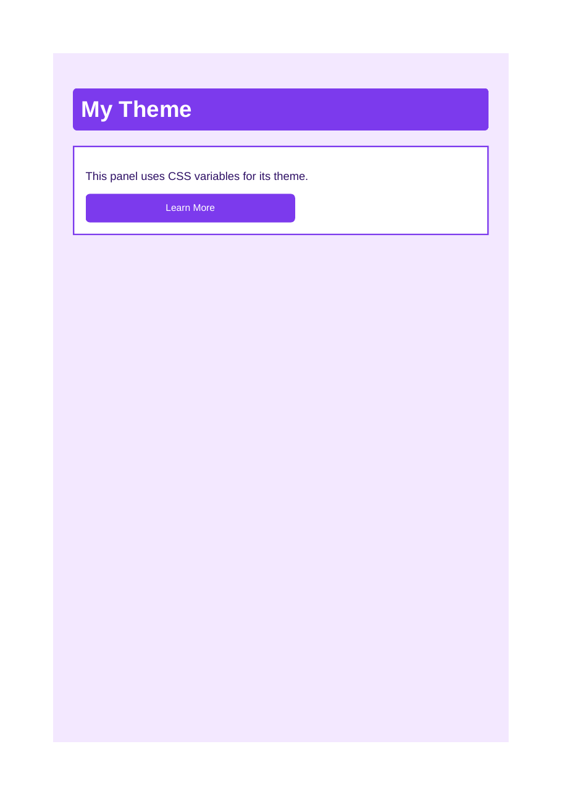
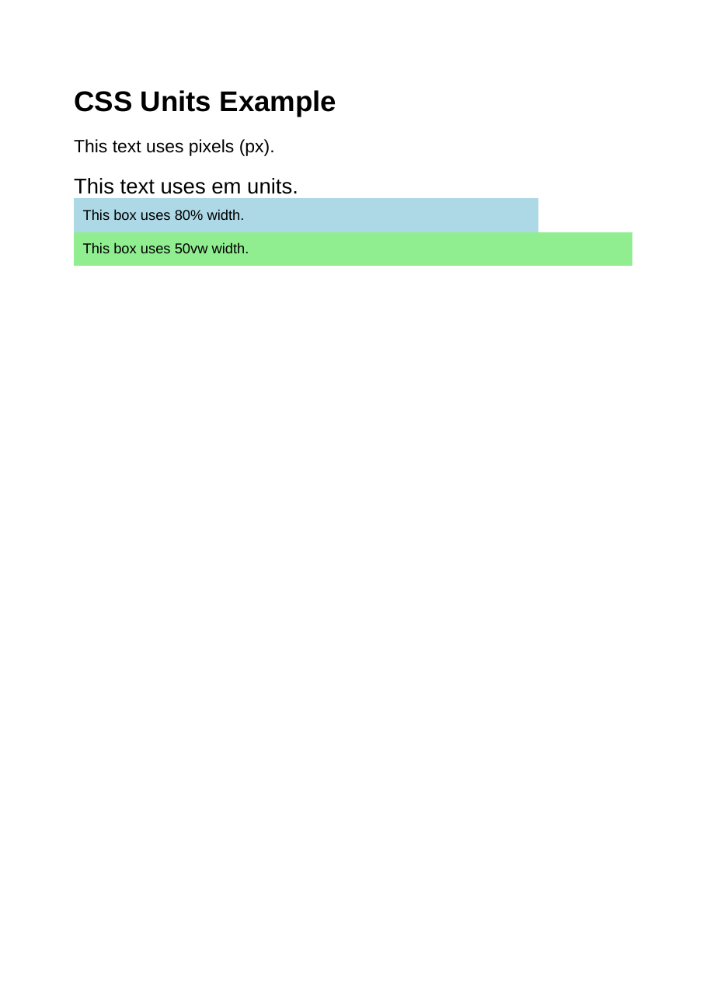
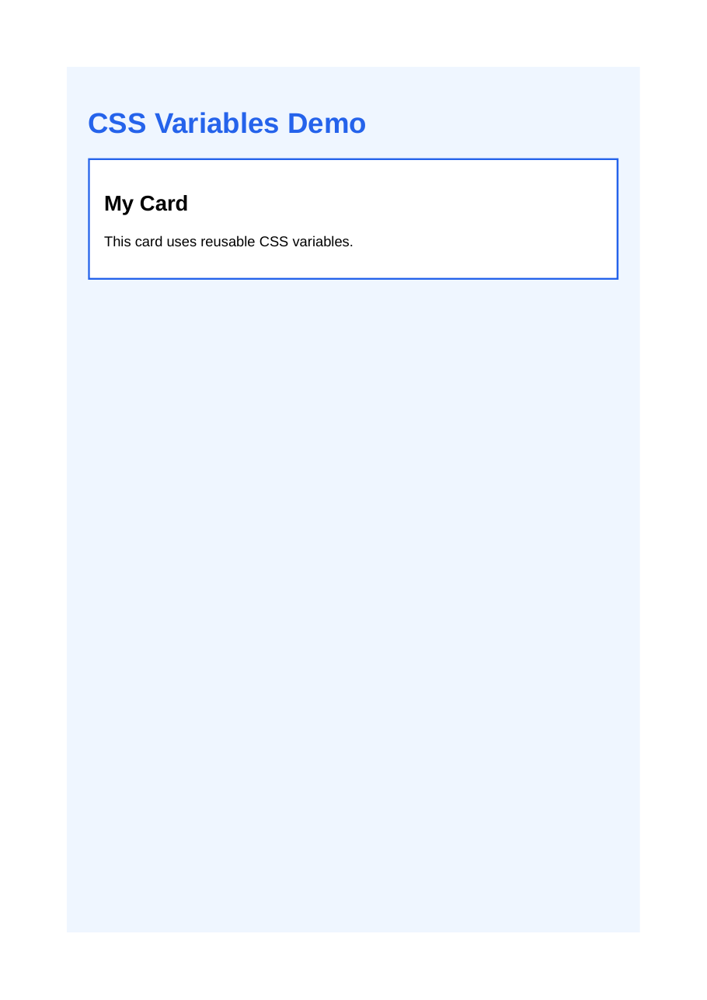

# Lab 11 Units Css Variables

Each HTML file has its rendered output preview saved in the same folder with the same filename and a `.png` extension.

## theme.html
- HTML: [theme.html](theme.html)
- Output preview: [theme.png](theme.png)

## units.html
- HTML: [units.html](units.html)
- Output preview: [units.png](units.png)

## variables.html
- HTML: [variables.html](variables.html)
- Output preview: [variables.png](variables.png)

