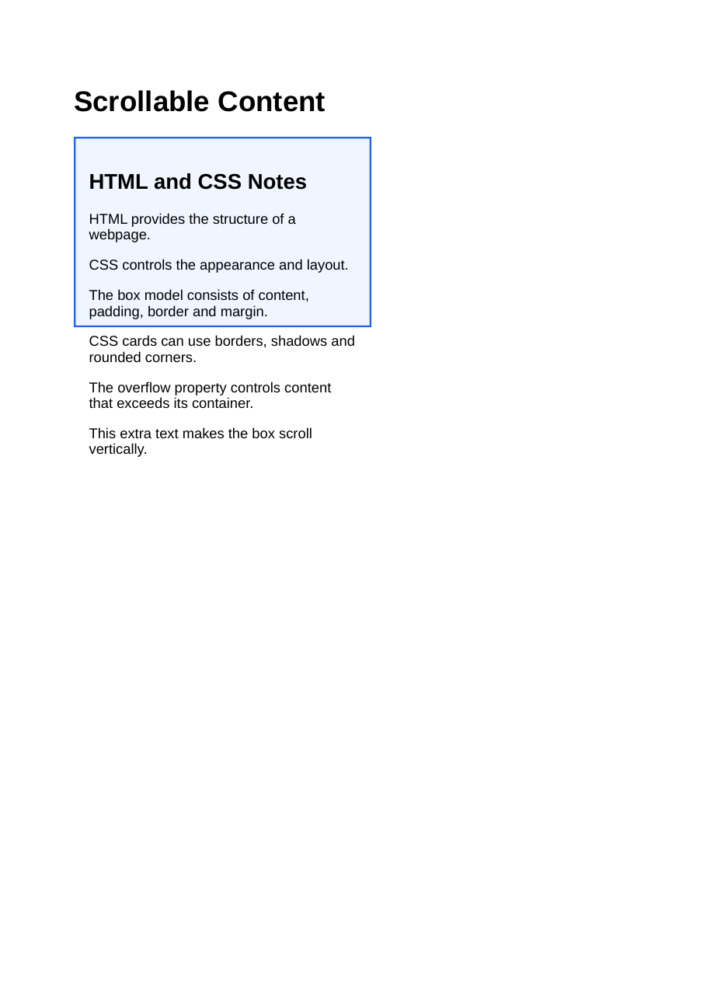

# Lab 12 Box Model Cards

Each HTML file has its rendered output preview saved in the same folder with the same filename and a `.png` extension.

## box-model.html
- HTML: [box-model.html](box-model.html)
- Output preview: [box-model.png](box-model.png)

## card.html
- HTML: [card.html](card.html)
- Output preview: [card.png](card.png)

## scrolling.html
- HTML: [scrolling.html](scrolling.html)
- Output preview: [scrolling.png](scrolling.png)

