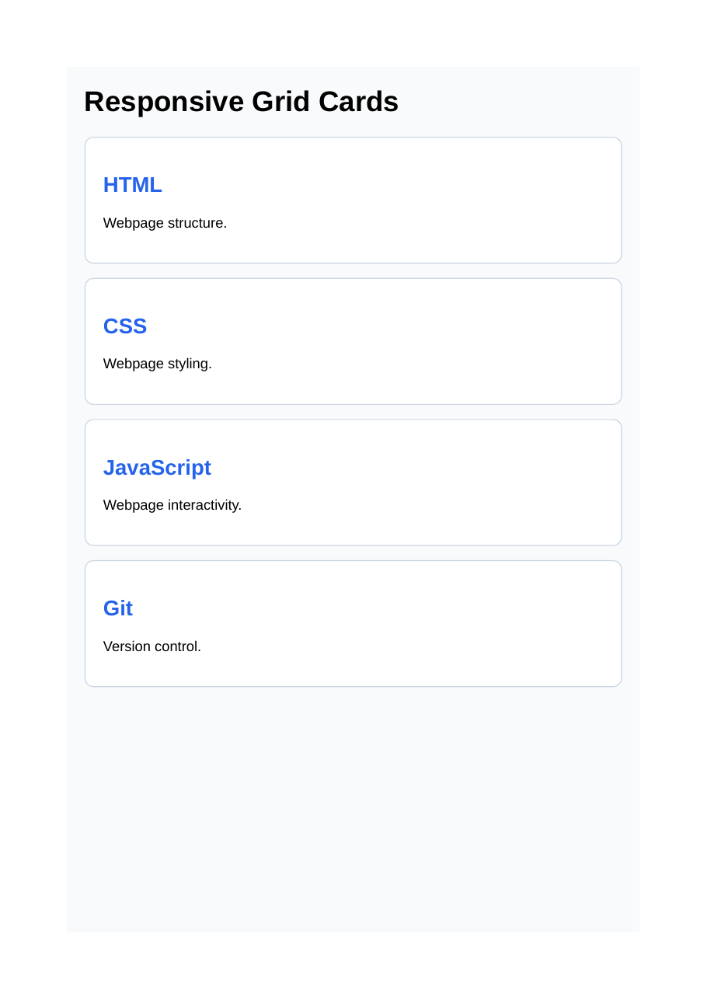

# Lab 14 Css Grid

Each HTML file has its rendered output preview saved in the same folder with the same filename and a `.png` extension.

## basic-grid.html
- HTML: [basic-grid.html](basic-grid.html)
- Output preview: [basic-grid.png](basic-grid.png)

## layout.html
- HTML: [layout.html](layout.html)
- Output preview: [layout.png](layout.png)

## responsive-grid.html
- HTML: [responsive-grid.html](responsive-grid.html)
- Output preview: [responsive-grid.png](responsive-grid.png)

