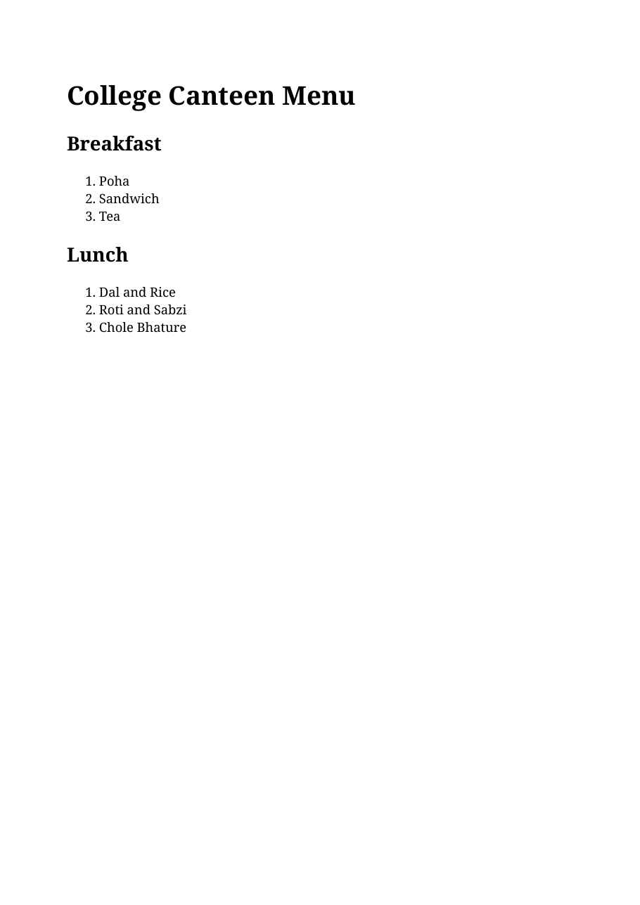
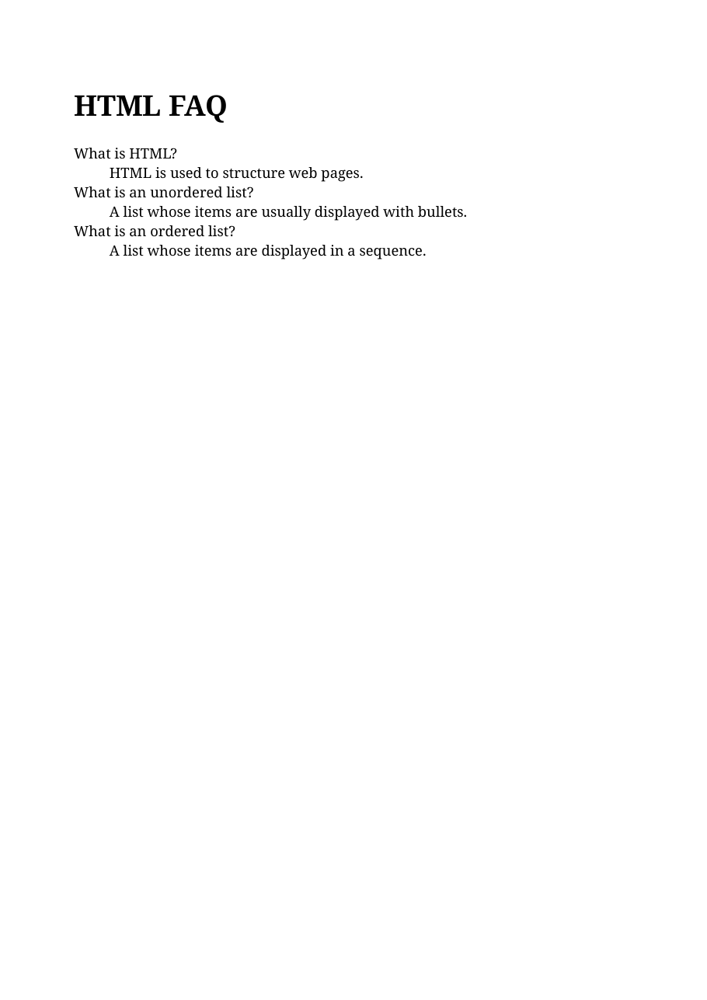

# Lab 6 Html Lists

Each HTML file has its rendered output preview saved in the same folder with the same filename and a `.png` extension.

## canteen-menu.html
- HTML: [canteen-menu.html](canteen-menu.html)
- Output preview: [canteen-menu.png](canteen-menu.png)

## faq.html
- HTML: [faq.html](faq.html)
- Output preview: [faq.png](faq.png)

## shopping-list.html
- HTML: [shopping-list.html](shopping-list.html)
- Output preview: [shopping-list.png](shopping-list.png)

