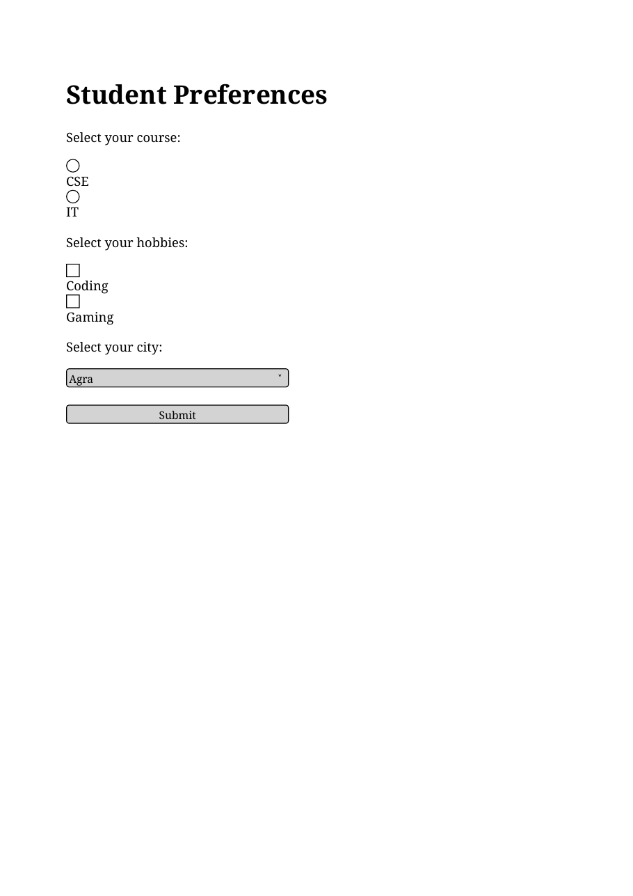
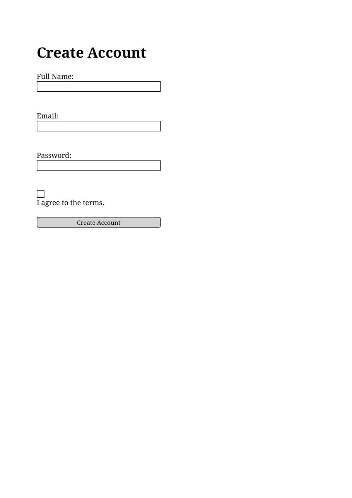
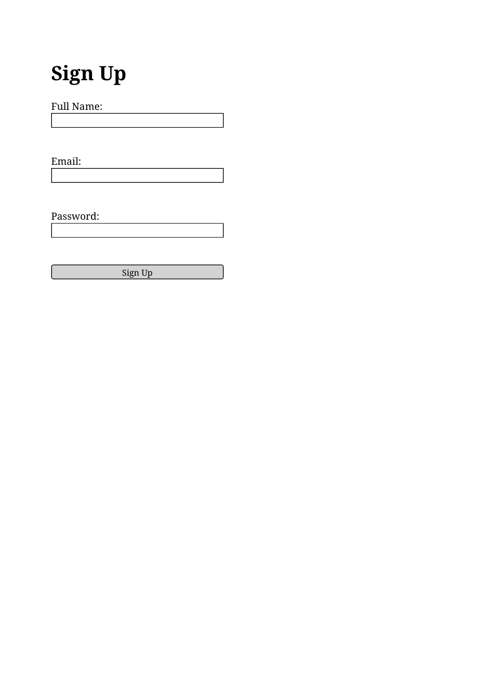

# Lab 8 Signup Forms

Each HTML file has its rendered output preview saved in the same folder with the same filename and a `.png` extension.

## choices.html
- HTML: [choices.html](choices.html)
- Output preview: [choices.png](choices.png)

## signup-required.html
- HTML: [signup-required.html](signup-required.html)
- Output preview: [signup-required.png](signup-required.png)

## signup.html
- HTML: [signup.html](signup.html)
- Output preview: [signup.png](signup.png)

